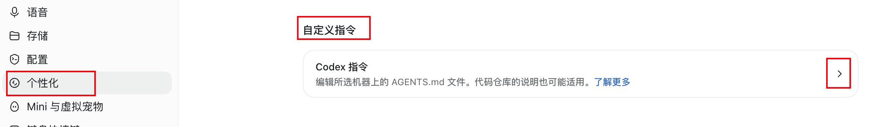

# 在“个性化”里设置使用习惯

先安装两个技能，再添加下面的指令。个性化设置保存使用偏好，技能目录保存具体规则；只填写名字不会自动安装技能。

## 打开设置

在 Codex 中进入 **设置 → 个性化 → 自定义指令 → Codex 指令**。以下截图由本项目维护者提供，展示的是其使用版本；其他版本的界面名称可能略有不同。



## 填入指令

截图展示了简短写法，包含 `@lieflat-less-ai-tone 自然语气` 和 `@Goal Prompt Template 当我需要你来给我执行最佳实践的时候使用这个技能`。


推荐复制下面这段，使用技能的实际名称，说明何时调用及执行边界。

```text
完成中文写作后，使用 $lieflat-less-ai-tone（自然语气）检查成稿。只修改 SKILL.md 明确命中的表达，保留未命中的原文、事实和文章框架。

我说“你来执行最佳实践”或“一句话达成目的”时，使用 $goal-prompt-template（Goal Prompt Template）明确目标、范围、交付物和完成标准，再完成我已授权的任务。信息不阻塞时自行合理假设，只追问真正影响执行的问题。若我只要求生成提示词，则只输出可复制的提示词。
```

也可复制 [纯文本示例](../examples/personalization.txt)，追加到已有指令中。保留原有设置。

## 使用技巧

- 在对话中用 `$lieflat-less-ai-tone` 或 `$goal-prompt-template` 显式调用。若技能选择器支持 `@`，可从列表选择对应技能；`Goal Prompt Template` 是显示名，`goal-prompt-template` 是技能名。
- “自然语气”适合成稿清理。先完成内容，再检查表达；没有命中规则的句子保持原样。
- 需要提示词时写“帮我生成提示词”；需要执行时写“你来执行最佳实践”，并给出目标和已知限制。
- 两个技能配合时，先用 Goal Prompt Template 明确任务，完成写作后再用自然语气清理成稿。
- 更新后若技能列表没有刷新，重启 Codex。排查同名技能时检查是否在多个目录重复安装。

个性化面板会编辑所选机器的 `AGENTS.md`。项目中的指令也可能影响当前任务。

参考：[OpenAI 官方设置说明](https://learn.chatgpt.com/docs/reference/settings)、[AGENTS.md 指南](https://learn.chatgpt.com/docs/agent-configuration/agents-md)、[本地技能目录说明](https://learn.chatgpt.com/docs/build-skills)。截图路径来自维护者提供的界面，技能发现和指令机制参考官方文档。核对日期：2026-10-19。
